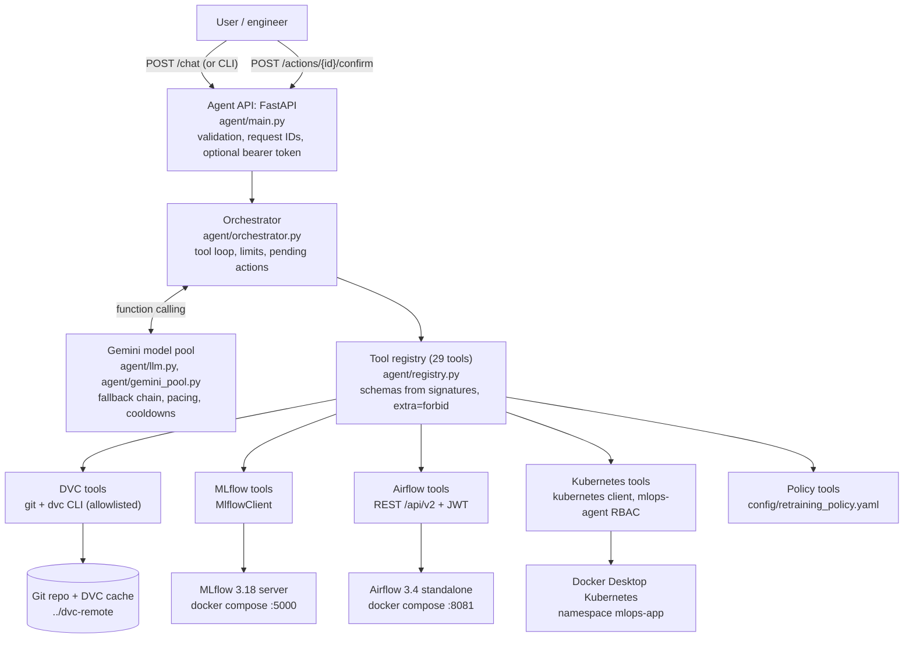
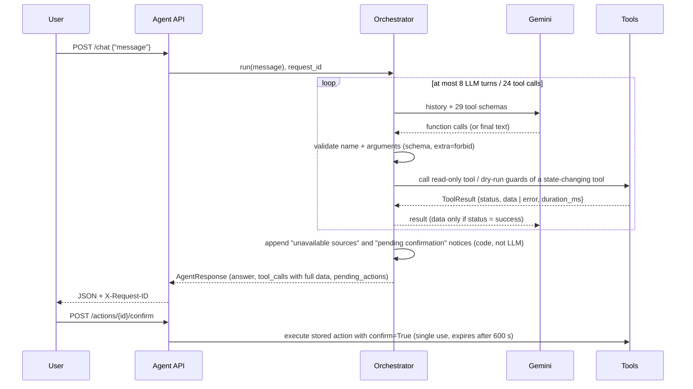
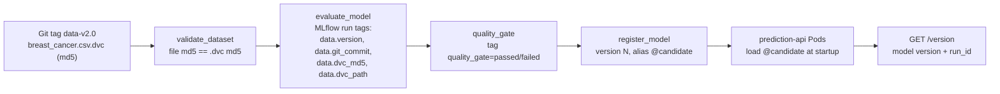

# Architecture

The MLOps agent answers natural-language questions about a breast-cancer classifier's data,
experiments, training pipeline and deployment. Every operational claim comes from a structured
tool call against the real system. The LLM chooses tools and writes the answer; it can never
change system state on its own.

## 1. System overview



| Layer | Component | Technology |
|---|---|---|
| Interface | `agent/main.py` (HTTP), `agent/cli.py` (terminal) | FastAPI, pydantic v2 |
| Reasoning | `agent/orchestrator.py`, `agent/llm.py`, `agent/gemini_pool.py` | Google Gemini (free tier), manual function calling via `google-genai` |
| Tools | `agent/tools/{dvc,mlflow,airflow,kubernetes,policy}_tools.py` | subprocess, `MlflowClient`, `requests`, `kubernetes` client |
| Data | `data/raw/breast_cancer.csv` (+ `.dvc`), `dvc.yaml`, `params.yaml` | DVC 3.67 with a local folder remote |
| Experiments | MLflow tracking server + model registry | MLflow 3.18, SQLite backend (Docker) |
| Orchestration | `dags/training_pipeline.py` | Airflow 3.4 (`airflow standalone`, Docker) |
| Serving | `api/main.py`, `Dockerfile`, `kubernetes/*.yaml` | FastAPI, Kubernetes 1.36 (Docker Desktop) |
| CI | `.github/workflows/ci.yml` | GitHub Actions: ruff + pytest on Python 3.11 and 3.14 |

## 2. Request flow



1. **Validation.** The request body is a pydantic model (1-4000 characters). Every function
   call the LLM makes is validated against a schema generated from the tool's Python
   signature. Unknown tools and unknown or extra arguments are refused before anything runs.
2. **Evidence.** Each tool returns a `ToolResult` whose `data` is set only on `success`. For
   `error`, `timeout`, `invalid_request` or `rejected`, the LLM receives only the error text, so
   it has nothing to paraphrase into a fake result. The orchestrator itself adds a list of
   unavailable sources to the answer.
3. **Bounded loop.** Eight LLM turns and 24 tool calls at most, then a forced final answer.
   Large results are truncated for the LLM (12,000 characters) but returned in full in
   `tool_calls`.
4. **Traceability.** A `request_id` (ContextVar) is attached to every log line: `agent_request`,
   `llm_call`, `tool_call`, `action_executed`. Logs record the tool, status and duration, never
   arguments or outputs.

## 3. Safety and permission model

State changes go through four independent checks:

| Layer | Mechanism | Defeats |
|---|---|---|
| 1. Schema | Arguments validated against the tool's schema; `confirm` is not part of any schema | Made-up tools or arguments, the LLM passing `confirm=True` |
| 2. Tool guard | Allowlists checked before any network call: DAG in `AIRFLOW_ALLOWED_TRIGGER_DAGS`, namespace in `K8S_ALLOWED_NAMESPACES`, replicas 1-5, name format | Operations outside the approved scope, even when confirmed |
| 3. Human confirmation | A permitted state change becomes a *pending action* (single use, 600 s TTL). Only `POST /actions/{id}/confirm` executes it, with the stored arguments | Autonomous retraining or restarts; replay of an old approval |
| 4. Platform RBAC | The `mlops-agent` ServiceAccount can only read `mlops-app` and patch Deployments and their scale; the token lives in `~/.kube/config`, not the repo | Any bypass of the code, other namespaces, Secrets, deletes |

The DVC tools run only allowlisted `dvc`/`git` subcommands without a shell, with revisions and
paths validated and confined to the repository. The MLflow tools are read-only. The DAG
promotes nothing unless its own validation and quality gate pass.

**Retraining is never started from a question.** The system prompt forbids it, and the trigger
tool would produce only a proposal anyway. Retraining is *recommended* only when
`policy_check_retraining` reports a violated rule of the explicit policy
(`config/retraining_policy.yaml`): model age at most 30 days, F1 at least 0.90, ROC-AUC at
least 0.95, quality gate passed, trained on the newest data version. A rule without evidence is
`unknown`, not violated.

**Secrets** (Gemini key, Airflow password) come only from the environment (`.env`, git-ignored).
Airflow JWTs are cached in memory and never logged. Task and Pod log lines are redacted
(`password`, `token`, `secret`, `api_key` or `authorization` followed by `=` or `:` keeps the key
and replaces the value with `***`), and tool logs never include arguments.

## 4. Provenance chain

How an answer such as "the served model was trained on `data-v1.0`" is grounded:



The agent walks the chain backwards:

1. `k8s_get_deployed_version` reads `/version` through the API server's service proxy.
2. `mlflow_get_model_versions` and `mlflow_get_run` give that run's tags.
3. `dvc_get_dataset_version` and `dvc_get_reproduction_steps` resolve the tag to a commit and
   the commands that restore it.

Because `validate_dataset` refuses data whose md5 differs from its `.dvc` record, the recorded
provenance cannot silently describe different bytes.

## 5. Training and data workflows

| Workflow | Path | Side effects | Purpose |
|---|---|---|---|
| Airflow DAG `training_pipeline` | validate -> preprocess -> train -> evaluate (MLflow) -> quality_gate -> register | MLflow run, registry version, `@candidate` alias | The governed path to a deployable model |
| DVC pipeline (`dvc repro`) | preprocess -> train -> evaluate (`metrics.json`) | None outside the workspace | Reproducibility check; `dvc.lock` pins every hash |

Both call the same functions in `training/train.py`. On `data-v2.0` they produce identical
metrics (F1 0.9861, ROC-AUC 0.9954). In the DAG, validation and the quality gate do not retry
(bad data or a weak model will not fix itself); the other tasks retry twice with exponential
backoff. A failed gate leaves `register_model` as `upstream_failed`, and `register_model`
re-checks the gate tag itself.

## 6. Deployment topology

| Service | Where | Address |
|---|---|---|
| MLflow tracking + registry | docker compose (`mlflow-data` volume) | `http://localhost:5000`; Pods reach it as `host.docker.internal:5000` |
| Airflow API server, scheduler, DAG processor, triggerer | docker compose (`airflow-state`, `airflow-logs` volumes) | `http://localhost:8081` (`AIRFLOW_HOST_PORT`) |
| Prediction API | Kubernetes `mlops-app`: Deployment (2 replicas, `maxUnavailable: 0`), ClusterIP Service, ConfigMap | in-cluster `prediction-api:80`; the agent uses the API proxy |
| Agent API | host process (`uvicorn agent.main:app`) | `http://localhost:8000` |

The prediction API separates liveness (process alive) from readiness (model loaded). A model
that fails to load therefore takes a Pod out of the Service without restart loops, and the
reason appears in `/health/ready` and the Pod logs.

## 7. Key design decisions

| Decision | Alternatives considered | Reason |
|---|---|---|
| Manual function calling, own orchestrator | LangChain or other agent frameworks; SDK automatic function calling | Every call passes through one place that validates, logs, enforces confirmation and records evidence. Few dependencies, deterministic tests with a scripted LLM |
| Google Gemini free tier with a model pool | Paid API; a single model | No budget for billing. Free-tier quotas are 20 requests/day on the best models, so the pool falls back by availability, persists cooldowns and paces requests |
| Confirmation via a separate endpoint | Confirmation inside the chat text | The LLM cannot produce a confirmation; a human HTTP call is required, and the action is single use with the stored arguments |
| Retraining policy as a YAML file plus a tool | Letting the LLM judge "needs retraining" | Recommendations must cite an explicit, reviewable rule and evidence; missing evidence becomes `unknown` |
| `MlflowClient` only | MLflow REST or UI scraping | Required by the spec; typed entities; works the same against SQLite in tests |
| Airflow REST API (`/api/v2`) with JWT | Airflow CLI via `docker exec` | Required authenticated API; no container access needed |
| Restricted ServiceAccount context for the agent | Admin kubeconfig | Least privilege enforced by the cluster, not only by code |
| Local folder DVC remote | S3/GCS | No cloud account; the remote is still separate from the repo and the cache (proved with a fresh-clone `dvc pull`) |
| Docker Desktop Kubernetes, `airflow standalone`, SQLite | kind/minikube, CeleryExecutor, PostgreSQL | Smallest setup that runs on one Windows laptop; the agent only depends on the APIs, so a production-grade backend could be swapped in unchanged |

## 8. Repository layout

```
agent/            Agent API, orchestrator, LLM pool, registry, schemas, tools/
api/              FastAPI inference service (deployed to Kubernetes)
dags/             Airflow training DAG
training/         Shared training code, DVC stages, dataset builder
kubernetes/       Namespace, ConfigMap, Deployment, Service, agent RBAC
config/           Retraining policy
docker/airflow/   Airflow image (adds mlflow-skinny under Airflow constraints)
scripts/          Evidence export and transcript rendering
docs/             Technical report, exported evidence, agent conversations
tests/            190 pytest cases; external systems mocked or faked
```
